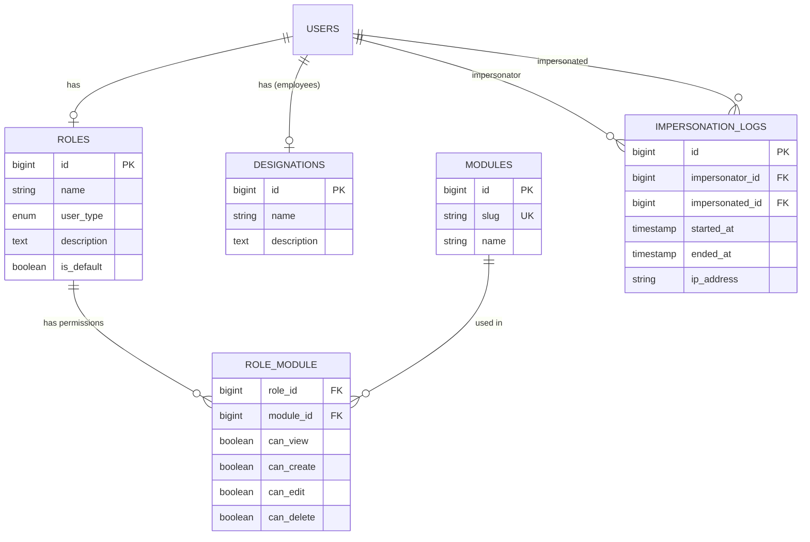

# Role Management Module — Implementation Plan

## Background

The Affitrace Agency app currently has four user types (`admin`, `affiliate`, `advertiser`, `employee`) stored as a `user_type` enum on the `users` table. Access control is enforced by simple middleware that checks `user_type` — there is **no granular permission system**. The admin sidebar is hardcoded with all modules visible. Employees currently only have a profile page.

**Goal:** Build a Role-Based Access Control (RBAC) system so the admin can assign specific module access to affiliates, advertisers, and employees (with designations like Manager, Sales Executive, Clerk, etc.), and allow admin (and permitted employees) to impersonate affiliate/advertiser accounts.

---

## Confirmed Decisions

| Decision | Confirmed Approach |
|---|---|
| **Designations** | Dynamic DB lookup table (not hardcoded) — admin can add/edit |
| **Impersonation session limit** | **60 minutes** — token auto-expires |
| **Impersonation banner** | ✅ Impersonator sees a banner: "Acting as [User Name]" |
| **Impersonated user notification** | ✅ Affiliate/advertiser is notified when their account is accessed |
| **Employee in UserType enum** | ✅ Add [Employee](file:///f:/xampp/htdocs/affitrace_agency/REST-BACKEND/app/Http/Middleware/EmployeeMiddleware.php#10-40) to PHP enum + login page |

---

## Proposed Changes

### 1. Database — New Tables & Migrations

#### [NEW] Migration: `create_designations_table`
| Column      | Type        | Notes                |
|-------------|-------------|----------------------|
| id          | bigint PK   | Auto-increment       |
| name        | string      | e.g., Manager, Clerk |
| description | text (null) | Optional description |
| timestamps  |             |                      |

#### [NEW] Migration: `create_modules_table`
| Column      | Type        | Notes                          |
|-------------|-------------|--------------------------------|
| id          | bigint PK   | Auto-increment                 |
| slug        | string (unique) | e.g., `offers`, `reports`  |
| name        | string      | Display name                   |
| description | text (null) |                                |
| timestamps  |             |                                |

Seeded with: `dashboard`, `offers`, `affiliates`, `advertisers`, `reports`, `mmp`, `payments`, `integrations`, `invoices`, `role_management`, `impersonation`

#### [NEW] Migration: `create_roles_table`
| Column       | Type        | Notes                                   |
|--------------|-------------|-----------------------------------------|
| id           | bigint PK   |                                         |
| name         | string      | e.g., "Affiliate Basic", "Manager Role" |
| user_type    | enum        | `admin`, `affiliate`, `advertiser`, `employee` — indicates who this role is for |
| description  | text (null) |                                         |
| is_default   | boolean     | Default role for new users of this type |
| timestamps   |             |                                         |

#### [NEW] Migration: `create_role_module_table` (pivot)
| Column       | Type        | Notes                                        |
|--------------|-------------|----------------------------------------------|
| id           | bigint PK   |                                              |
| role_id      | FK → roles  |                                              |
| module_id    | FK → modules|                                              |
| can_view     | boolean     | default true                                 |
| can_create   | boolean     | default false                                |
| can_edit     | boolean     | default false                                |
| can_delete   | boolean     | default false                                |
| timestamps   |             |                                              |

#### [NEW] Migration: `add_role_and_designation_to_users_table`
| Column         | Type           | Notes                            |
|----------------|----------------|----------------------------------|
| role_id        | FK → roles (nullable) | User's assigned role        |
| designation_id | FK → designations (nullable) | Only for employees  |

#### [NEW] Migration: `create_impersonation_logs_table`
| Column            | Type        | Notes                                   |
|-------------------|-------------|-----------------------------------------|
| id                | bigint PK   |                                         |
| impersonator_id   | FK → users  | Admin/employee who initiated            |
| impersonated_id   | FK → users  | Affiliate/advertiser being accessed     |
| started_at        | timestamp   |                                         |
| ended_at          | timestamp (null) |                                    |
| ip_address        | string      |                                         |
| notified          | boolean     | Whether the impersonated user was notified |
| timestamps        |             |                                         |

---

### 2. Backend — Models

#### [NEW] [Designation.php](file:///f:/xampp/htdocs/affitrace_agency/REST-BACKEND/app/Models/Designation.php)
Eloquent model with `hasMany('User')` relationship.

#### [NEW] [Module.php](file:///f:/xampp/htdocs/affitrace_agency/REST-BACKEND/app/Models/Module.php)
Eloquent model with `belongsToMany('Role')` via `role_module` pivot (with `can_view`, `can_create`, `can_edit`, `can_delete`).

#### [NEW] [Role.php](file:///f:/xampp/htdocs/affitrace_agency/REST-BACKEND/app/Models/Role.php)
Eloquent model with `belongsToMany('Module')` via pivot and `hasMany('User')`.

#### [NEW] [ImpersonationLog.php](file:///f:/xampp/htdocs/affitrace_agency/REST-BACKEND/app/Models/ImpersonationLog.php)
Eloquent model for audit logging.

#### [MODIFY] [User.php](file:///f:/xampp/htdocs/affitrace_agency/REST-BACKEND/app/Models/User.php)
- Add `role_id`, `designation_id` to `$fillable`
- Add `role()`, `designation()` relationships
- Add helper: `hasModuleAccess($moduleSlug, $action = 'can_view'): bool`
- Add helper: `canImpersonate(): bool`

#### [MODIFY] [UserType.php](file:///f:/xampp/htdocs/affitrace_agency/REST-BACKEND/app/Enums/UserType.php)
- Add `case Employee = 'employee';`

---

### 3. Backend — Middleware

#### [NEW] [CheckModuleAccess.php](file:///f:/xampp/htdocs/affitrace_agency/REST-BACKEND/app/Http/Middleware/CheckModuleAccess.php)
Parameterized middleware: `module.access:offers,can_view`. Checks if the authenticated user's role has the specified permission for the specified module. Admin always passes. Returns 403 if denied.

#### [MODIFY] [Kernel.php](file:///f:/xampp/htdocs/affitrace_agency/REST-BACKEND/app/Http/Kernel.php)
- Register `'module.access' => CheckModuleAccess::class` alias.

---

### 4. Backend — Controllers & Routes

#### [NEW] [RoleController.php](file:///f:/xampp/htdocs/affitrace_agency/REST-BACKEND/app/Http/Controllers/Admin/RoleController.php)
CRUD for roles and their module permissions:
- `GET  /admin/roles` — List all roles
- `POST /admin/roles` — Create role with module permissions
- `GET  /admin/roles/{id}` — Get role details + permissions
- `PUT  /admin/roles/{id}` — Update role + permissions
- `DELETE /admin/roles/{id}` — Delete role (prevent if users assigned)

#### [NEW] [DesignationController.php](file:///f:/xampp/htdocs/affitrace_agency/REST-BACKEND/app/Http/Controllers/Admin/DesignationController.php)
CRUD for employee designations:
- `GET  /admin/designations` — List all
- `POST /admin/designations` — Create
- `PUT  /admin/designations/{id}` — Update
- `DELETE /admin/designations/{id}` — Delete (prevent if users assigned)

#### [NEW] [ModuleController.php](file:///f:/xampp/htdocs/affitrace_agency/REST-BACKEND/app/Http/Controllers/Admin/ModuleController.php)
- `GET /admin/modules` — List all modules (read-only, used by UI for role builder)

#### [NEW] [ImpersonationController.php](file:///f:/xampp/htdocs/affitrace_agency/REST-BACKEND/app/Http/Controllers/Admin/ImpersonationController.php)
- `POST /admin/impersonate/{user_id}` — Start impersonation (creates 60-min scoped token, logs entry, notifies impersonated user)
- `POST /admin/stop-impersonate` — End impersonation (revokes scoped token, logs exit)
- `GET  /admin/impersonation-logs` — View audit log

#### [MODIFY] [UserManagement in AdminController](file:///f:/xampp/htdocs/affitrace_agency/REST-BACKEND/app/Http/Controllers/Admin/AdminController.php)
- When creating/editing affiliates, advertisers, employees → add ability to assign a role
- When creating/editing employees → add ability to assign a designation

#### [MODIFY] [api.php](file:///f:/xampp/htdocs/affitrace_agency/REST-BACKEND/routes/api.php)
- Add new role, designation, module, impersonation routes under `admin` prefix
- Optionally add `module.access` middleware to existing route groups (can be done incrementally)

#### [MODIFY] [AuthController.php](file:///f:/xampp/htdocs/affitrace_agency/REST-BACKEND/app/Http/Controllers/Api/AuthController.php)
- On login, include the user's role + permissions in the response, so the UI can render the correct sidebar/modules
- This avoids the need for a separate API call on every page load

---

### 5. Frontend — Admin UI Pages

#### [NEW] `UI/ADMIN/roles/` directory
- `list.php` — Table of all roles with user_type filter, edit/delete buttons
- `create.php` — Form: role name, user_type selector, permission matrix (modules × actions checkbox grid)
- `edit.php` — Same form, pre-populated

#### [NEW] `UI/ADMIN/designations/` directory
- `list.php` — Table of designations with edit/delete
- `create.php` — Form: name, description

#### [NEW] `UI/ADMIN/employees/` directory
- `list.php` — Table of employees with role & designation columns
- `create.php` — Form: user details + role dropdown + designation dropdown
- `edit.php` — Same, pre-populated

#### [NEW] `UI/ADMIN/impersonation/` directory
- `logs.php` — Audit log table of impersonation sessions

#### [MODIFY] [sidebar.php](file:///f:/xampp/htdocs/affitrace_agency/UI/ADMIN/includes/sidebar.php)
- On page load, read the logged-in user's permissions from `sessionStorage`/`localStorage` (set during login)
- Conditionally show/hide sidebar menu items based on module permissions
- Add new sidebar entries: "Role Management", "Designations", "Employees" under a "User Management" heading

#### [MODIFY] [login.php](file:///f:/xampp/htdocs/affitrace_agency/UI/login.php)
- Add `<option value="employee">Employee</option>` to the user_type dropdown
- On successful employee login, redirect to [ADMIN/dashboard.php](file:///f:/xampp/htdocs/affitrace_agency/UI/ADMIN/dashboard.php) (employees see the admin panel with restricted modules)

#### [MODIFY] Affiliate/Advertiser sidebars
- Similarly, read role permissions from session and show/hide sidebar items

#### Impersonation UX (on Affiliate/Advertiser list pages)
- Add a "Login As" button next to each affiliate/advertiser in the admin list views
- Clicking it calls the impersonate API, creates a 60-min scoped token, and redirects to the affiliate/advertiser dashboard
- A persistent top banner displays: **"Acting as [User Name] — [Exit]"**
- The impersonated affiliate/advertiser receives an email notification that their account was accessed

---

### 6. Architecture Diagram

---

## Verification Plan

### Automated Tests
- **Migration test:** `php artisan migrate:fresh` — verify all new tables are created without errors
- **Seeder test:** `php artisan db:seed --class=ModuleSeeder` — verify all 11 modules are seeded
- **API tests** (Postman or PHPUnit feature tests):
  - Create a role via `POST /api/admin/roles` → verify 201 + correct pivot data
  - Assign role to user → verify `hasModuleAccess()` returns correct result
  - Access a module-protected route without permission → verify 403
  - Impersonate a user → verify scoped token works and log is created

### Manual Verification
1. **Login as Admin** → navigate to Role Management → create a new role for "affiliate" type with only "dashboard" and "offers" modules enabled → assign this role to an affiliate user
2. **Login as that Affiliate** → verify sidebar only shows Dashboard and Offers
3. **Login as Admin** → go to Affiliates list → click "Login As" → verify you are redirected to the affiliate dashboard acting as that user → verify a banner shows "Acting as [Name]" → click "Exit" → verify you return to admin
4. **Login as Admin** → create an Employee with designation "Sales Executive" and a role that has access to affiliates + offers → Login as that Employee → verify only permitted modules are visible
5. **Check impersonation logs** → verify all impersonation sessions are recorded with timestamps and IP
